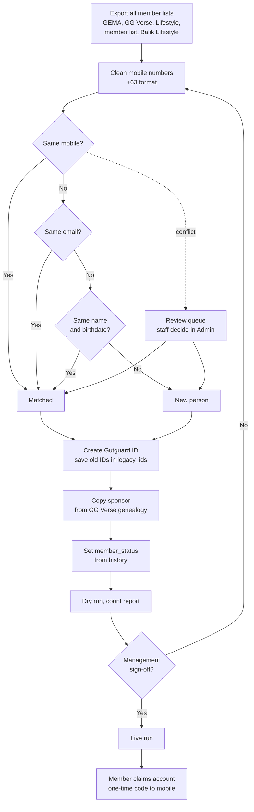
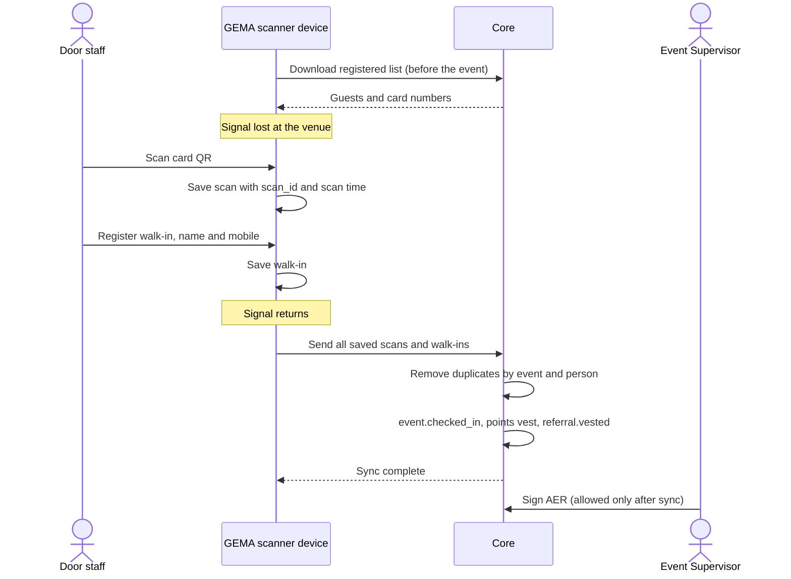
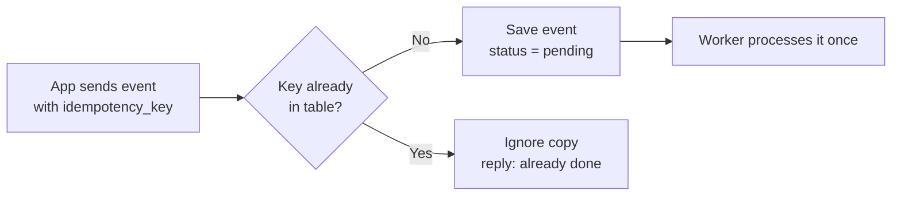
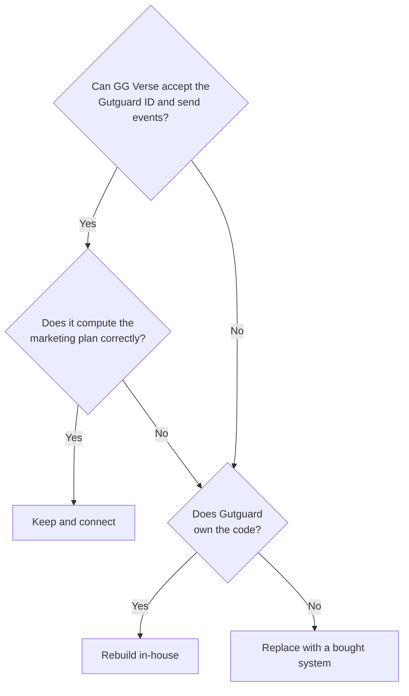
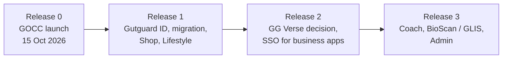

# Annex A: Build Readiness

**Parent document:** Gutguard Unified Platform Architecture v2 (Reconciled)
**Date:** 3 October 2026
**Owner:** CSA, Founder, Chairman and CEO, Gutguard Corp.
**Status:** Proposed. For devs and management.

The v2 architecture is sound as a design. This annex closes six gaps that stand between the design and a working system.

| No. | Gap | Why it matters |
|---|---|---|
| A1 | Member migration and merge | 6,844 registered members already sit in several systems, with duplicates |
| A2 | Offline QR check-in | QR check-in vests referrals and GOCC credits; many venues have weak signal |
| A3 | One-time event keys | A double scan must never vest a referral or a credit twice |
| A4 | GG Verse decision | The commission engine is the hardest part of the system |
| A5 | Minimum first release | GOCC launches on 15 October 2026; the team is small |
| A6 | One source for the member record | The earlier spine schema and v2 must not compete |

---

## A1. Member migration and merge

**Rule:** One real person gets one Gutguard ID. No person is lost, and no person is created twice.

### Steps

1. **Collect.** Export every member list: GEMA users, GG Verse accounts, the Lifestyle prototype users, the 6,844 registered members list and the Balik Lifestyle segmentation workbook.
2. **Clean mobile numbers.** Convert every mobile number to one format: `+63` followed by 10 digits.
3. **Auto-match in this order:**
    1. Same mobile number → same person.
    2. Same email → same person.
    3. Same full name and same birthdate → same person.
4. **Send conflicts to a review queue.** Examples: the same mobile with two different names, or the same name with two different mobiles. Staff decide each case in the Admin portal.
5. **Create the Gutguard ID** for each confirmed person. Save every old ID in the `legacy_ids` table (below).
6. **Copy the sponsor.** Take each person's sponsor from GG Verse genealogy, because GG Verse is the record of the network.
7. **Set member_status from history.**
    - `pay_in_status` from past orders
    - `active` from transactions in the last 60 days
    - `member_type` (A builder, B seller, C user) tagged by the system from history
    - `base_status` from BASE records; no record means `not_started`
8. **Dry run first.** Run the full migration on a copy. Report the counts: total people, auto-matched, sent to review, created new.
9. **Sign-off.** Management approves the dry-run counts before the live run.
10. **Claim on first login.** A migrated member logs in with a one-time code sent to his mobile. This links him to his existing Gutguard ID.

### legacy_ids table (new, in Core)

| Field | Meaning |
|---|---|
| user_id | The new Gutguard ID |
| source_system | gema, ggverse, lifestyle, member_list |
| legacy_id | The old ID in that system |
| match_method | mobile, email, name_birthdate, manual |
| matched_by | Staff ID, for manual matches |
| matched_at | Date and time of the match |

### Diagram: migration flow



---

## A2. Offline QR check-in

**Rule:** The event door must work with no signal. GEMA scans offline and syncs later. Credit time is the scan time, not the sync time.

### Steps

1. **Before the event,** the scanner device downloads the event's registered list while it still has signal.
2. **At the door,** each scan is saved on the device with:
    - `scan_id`, a unique ID made on the device
    - `gema_event_id`, `card_no`, scan time, scanner staff ID
3. **Walk-ins** register on the device with name and mobile. They are matched to a Gutguard ID during sync.
4. **When signal returns,** the device sends all saved scans.
5. **Core removes duplicates** by `gema_event_id + user_id` (see A3). Then it vests the guest's points and the inviter's Rewards Credit.
6. **The AER can be signed only after sync is complete.** The 24-hour AER rule therefore also sets the sync deadline.
7. **The device shows a sync status:** saved scans waiting, last sync time.

### Diagram: offline check-in



---

## A3. One-time event keys

**Rule:** Every event is processed once only. A second copy of the same event is ignored.

### Change to integration_events

Add one column with a unique rule:

```sql
ALTER TABLE integration_events
    ADD COLUMN idempotency_key TEXT;

CREATE UNIQUE INDEX integration_events_idem_key
    ON integration_events (idempotency_key);
```

If an app sends an event whose key already exists, the database refuses it. The worker treats that refusal as "already done", not as an error.

### Key per event type

| Event | Key is built from |
|---|---|
| event.checked_in | gema_event_id + user_id |
| referral.vested | invite_id |
| shop.order_paid | order_id |
| shop.delivered | order_id |
| points.earned | the source event's ID |
| points.redeemed | order_id |
| gema.aer_signed | aer_id |
| academy.credit_awarded | aer_id + user_id + role |
| academy.title_earned | user_id + title |
| base.activated | user_id |
| gentrep.enrolled | user_id |
| lifestyle.dose_logged | user_id + date + slot |
| lifestyle.night_completed | user_id + night_no |

### Diagram: one event, processed once



---

## A4. GG Verse decision

**Rule:** Decide this before Phase 3 starts. The answer changes the work for genealogy, commissions and ranks.

### Questions to answer first

1. Who owns the GG Verse code today: Gutguard or an outside vendor?
2. Can GG Verse accept the Gutguard ID as its user ID?
3. Does GG Verse have an API that can send and receive events?
4. Can GG Verse compute the official marketing plan without manual work?
5. Can GG Verse keep commissions and E-Points as two separate ledgers?

### Three options

| Option | Choose it when | Main cost |
|---|---|---|
| Keep and connect | Answers 2 to 5 are yes | Building the connection to Core |
| Rebuild in-house | Gutguard owns the code, but answers 3 to 5 are no | Time: the commission engine is the largest build |
| Replace with a bought system | Gutguard does not own the code, or the vendor cannot add an API | License fees and data migration |

### Diagram: decision path



---

## A5. Minimum first release

**Rule:** Do not wait for the full platform. Release in small parts, each tied to a real date.

GOCC launches on **15 October 2026**, 12 days from today. Full Single Sign-On will not be ready by then, and GOCC does not need it. GOCC needs GEMA to run events and record credits.

### Release 0: GOCC launch (target 15 October 2026)

Built on the current GEMA, with no SSO yet.

- [ ] GEMA Event Request with all role holders named
- [ ] Event approval by management
- [ ] QR check-in, including offline mode (A2)
- [ ] AER signing within 24 hours
- [ ] Members Training Record (Needed / Done / Left per title)
- [ ] `integration_events` table with `idempotency_key` (A3), so every GOCC action is counted from day one
- [ ] `legacy_ids` table, so GEMA users can be mapped to the Gutguard ID later

### Release 1: Buy and use (date to be set)

- [ ] Gutguard ID with mobile one-time code login
- [ ] Member migration (A1)
- [ ] Shop with Maya
- [ ] Lifestyle Rewards mode and Member mode, including the 5-Night Watch nights

### Release 2: Connect the business apps (date to be set)

- [ ] GG Verse decision applied (A4)
- [ ] GEMA, Academy and GG Verse on Single Sign-On
- [ ] Check-in vests referrals; AER writes Academy credits

### Release 3: Coach, health and admin (date to be set)

- [ ] Lifestyle Coach Phase 1
- [ ] BioScan / GLIS with consent
- [ ] Admin portal and management dashboards

### Diagram: release path



**Open question:** Operation 50 Stories is the company's single priority. Management must confirm which release it needs: Release 1 (Shop and Lifestyle) or a manual first season.

---

## A6. One source for the member record

**Rule:** The earlier spine files (`gutguard-spine-schema.md` and `gutguard-spine.ts`) and v2 describe the same thing. They are merged into one. After the merge, only v2 is used.

### Mapping

| Spine (earlier) | v2 (use this) |
|---|---|
| Member record | `users` + `profiles` + `member_status` |
| `event_log` | `integration_events` |
| `pay_in_status` | `member_status.pay_in_status` |
| `fork_type` | `member_status.fork_type` |
| `gentrep_invite` | `member_status.gentrep_invite` |
| Referral vesting (pending → vested) | `referral.vested`, triggered by `event.checked_in` |
| `createSuspect`, `register` | Core API: create Gutguard ID and member_status |
| `checkIn` | GEMA check-in → `event.checked_in` |
| `payIn` | Shop → `shop.order_paid` → `member.paid_in` |
| `enrollGentrep` | `gentrep.enrolled` |
| `bindTelegram` | Core API: link Telegram account to the Gutguard ID |
| `emit` | Write to `integration_events` |

### Steps

1. Jesh compares the spine files line by line with v2.
2. Any spine field missing in v2 is listed and sent to CSA for a ruling.
3. After the ruling, the spine files are marked "replaced by v2" and kept for history only.
