# Gutguard Unified Platform Architecture v2 (Reconciled)

**Date:** 3 October 2026
**Owner:** CSA, Founder, Chairman and CEO, Gutguard Corp.
**Status:** Replaces the devs' Architecture Proposal (v1)

All diagrams are in Mermaid. They render in GitHub, GitLab, VS Code (Mermaid extension) and Obsidian.

---

## Contents

1. Purpose and reconciliation rule
2. Core principle and member journey
3. System registry
4. Gates and business rules
5. Identity, roles and member record
6. Access matrix
7. Data ownership
8. Integration events
9. Key flows
10. Tech stack, security and reporting
11. Build phases
12. Open decisions

**Diagram index**

| No. | Diagram | Section |
|---|---|---|
| D1 | System architecture | 2 |
| D2 | Member journey (state machine) | 2 |
| D3 | Gate check: opening GEMA | 4 |
| D4 | Status state machines | 5 |
| D5 | Core database (ER) | 5 |
| D6 | Lifestyle main tables (ER) | 7 |
| D7 | Event trigger map | 8 |
| D8 | Event processing pipeline | 8 |
| D9 | Single Sign-On | 9 |
| D10 | Guest to member | 9 |
| D11 | 5-Night Watch trial | 9 |
| D12 | Member to Gentrep | 9 |
| D13 | GOCC credit | 9 |
| D14 | Lifestyle Coach, Phase 1 | 9 |
| D15 | Build phases | 11 |

---

## 1. Purpose and reconciliation rule

This v2 replaces the devs' Architecture Proposal (v1). It keeps the devs' technology and adds our locked business logic.

**The rule:** Our logic and design govern the member journey, the gates, the app roles and the names. The devs' document governs the tech stack, login method, domains, tables, event pattern and security. Where v1 and v2 differ on logic, v2 wins.

**Adopted from v1 (devs):**

- One Gutguard ID with Single Sign-On at `auth.gutguard.ph`
- Gutguard Core API at `api.gutguard.ph`
- One subdomain per app
- The `users`, `profiles`, `roles` and `user_roles` tables
- The `integration_events` table and sync worker
- The `audit_logs` table and the 10 security rules
- The tech stack: Next.js, React, TypeScript, Tailwind, Supabase, PostgreSQL
- The admin portal at `admin.gutguard.ph`

**Changed in v2 (our logic):**

- Lifestyle is the product-use app, not only a prospect app
- Our gates are written as Core rules, not left to roles alone
- Our funnel stages, E-Points ledger, BASE, GOCC credits and the Lifestyle Coach are added
- The event log moves to Phase 1

---

## 2. Core principle and member journey

One person, one Gutguard ID, one member record, many apps. Every app reads the person's place in the journey from Core.

### D1. System architecture

Apps never call each other directly. Every app logs in through Gutguard ID, then calls Core and writes events.

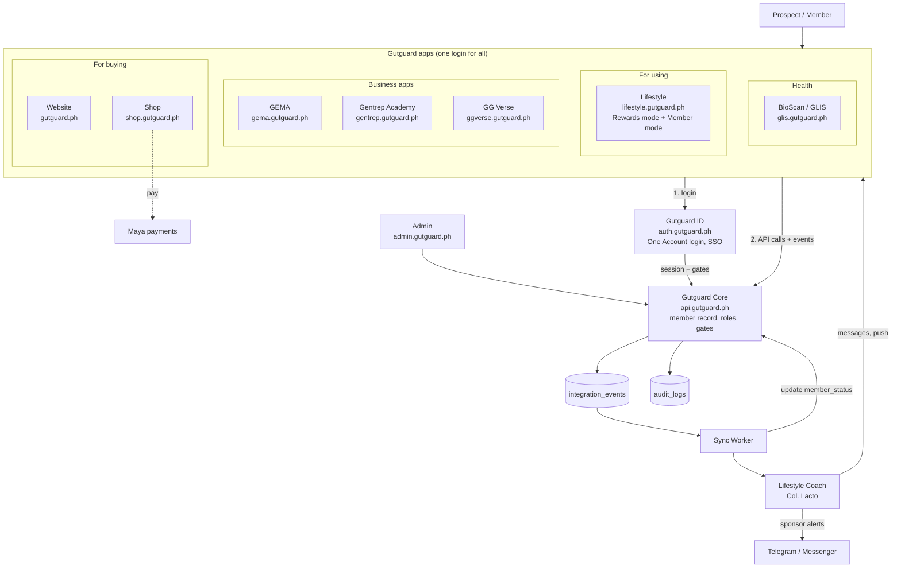

### D2. Member journey (state machine)

Everyone starts as a product user. BASE gates every earner.

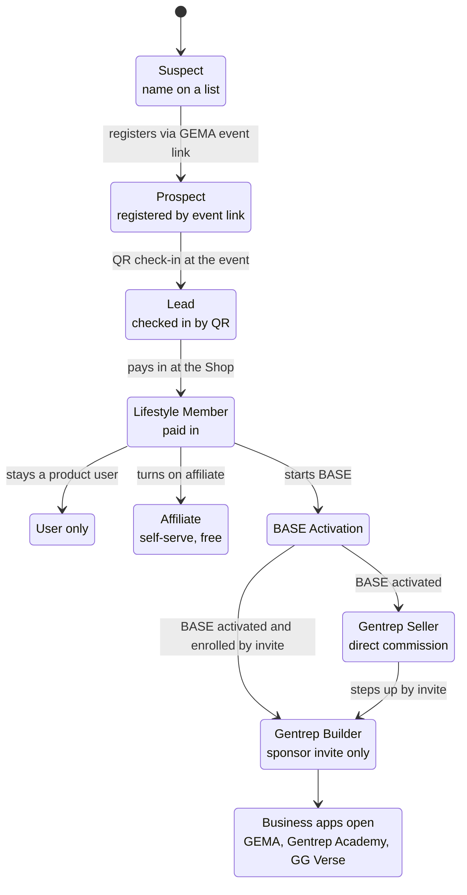

A Seller earns direct commission without GEMA and can step up to Builder at any time.

---

## 3. System registry

The ecosystem has 10 systems on the devs' domains. The website is for buying. Lifestyle is for using. GEMA, Gentrep Academy and GG Verse are business apps.

| System | Domain | Job | Who uses it |
|---|---|---|---|
| Gutguard ID | auth.gutguard.ph | One Account login and Single Sign-On for all apps | Everyone |
| Gutguard Core | api.gutguard.ph | Member record, roles, gates, event log, audit log | All apps (no screens) |
| Website | gutguard.ph | Public site: About, science, 5-Night Watch hook, BioScan story | Public |
| Shop | shop.gutguard.ph | All buying: 5-Night Watch ₱499, Lifestyle Protocol, subscriptions, gift for family. Same look as the website | Public, members |
| Lifestyle | lifestyle.gutguard.ph | One app, two modes. **Rewards mode:** guest card, invites, E-Points. **Member mode:** My Lifestyle (doses, Reveille / Midday / Taps), My Team, My Journey, BASE Activation, Gentrep Officer Dashboard | Prospects, all members |
| GEMA | gema.gutguard.ph | Events, event links, QR check-in, Event Requests, AER, Members Training Record, My Network Status | BASE-activated Builders, staff |
| Gentrep Academy | gentrep.gutguard.ph | GOCC courses, Zoom lectures, title checklists, certificates | BASE-activated Builders, instructors |
| GG Verse | ggverse.gutguard.ph | Genealogy, sales, commissions, ranks, bubble chart, Members Shop door | Paid-in Gentreps |
| BioScan / GLIS | glis.gutguard.ph | Lab results, GLIS score, MiAge (Beta), health consent | Members, doctors, medical staff |
| Admin | admin.gutguard.ph | Users, roles, orders, AER audit, reports, system health | Company staff |

**Lifestyle Coach (Col. Lacto)** is not a separate app. It is a Core service that sends text messages and push notifications inside all four member apps. No voice.

---

## 4. Gates and business rules

Core checks these rules on the server. An app never decides them alone, and the frontend is never trusted.

1. **One person, one ID.** The Lifestyle card number (16 digits) and QR belong to the Gutguard ID. When a guest becomes a member, the card keeps the same number.
2. **Product user first.** Everyone starts as a Lifestyle Member. Then each person picks one path: user only, Affiliate, Gentrep Seller or Gentrep Builder.
3. **Believer before builder.** Earning tools open only after the person's OWN pay-in, not a pay-in in his team.
4. **Gentrep by invitation.** Affiliate is self-serve. Gentrep enrolment needs an invite link issued by the sponsor for that one person.
5. **BASE gates every earner.** My Team, GEMA and the 2Lt Course open only after BASE Activation is complete. This applies to Sellers and Builders.
6. **Every invite is a GEMA event link.** A suspect enters the funnel only through an event invitation.
7. **Pay on attendance.** Registration is shown but not paid. The inviter's Rewards Credit lands only at the guest's GEMA QR check-in. Rewards Credit is product credit only, never cash.
8. **Two ledgers, never mixed.** E-Points (product credit) live in Lifestyle. Commissions live in GG Verse.
9. **Rank is earned, never bought.** GOCC titles (2Lt, 1Lt, Capt, Major) live in Gentrep Academy. Commission ranks live in GG Verse. The product ladder is separate from both.
10. **Not in GEMA, did not happen.** A GOCC credit is written only by a signed After Event Report (AER).
11. **No earning talk before pay-in.** Ginhawa pages and prospect screens show health content only.
12. **Active means one transaction in the last 60 days.**
13. **Buying for family.** E-Points go to the payer. The person bought for joins under the payer as referrer.

### D3. Gate check: opening GEMA

The same pattern applies to Academy and GG Verse.

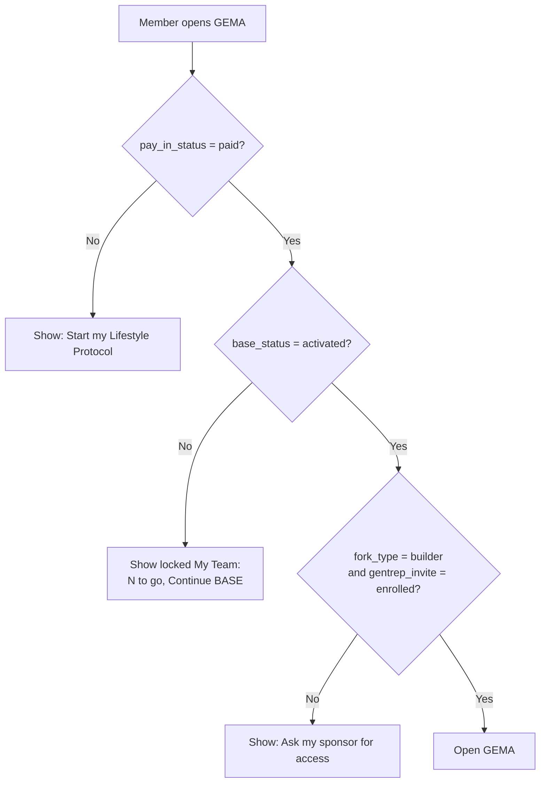

---

## 5. Identity, roles and member record

Keep the devs' `users`, `profiles`, `roles` and `user_roles` tables as written. Add one `member_status` table in Core.

- **Roles** say what a person may open.
- **Status** says where the person is in the journey.
- The gates read status, not roles alone.

### member_status (new, in Core)

| Field | Values |
|---|---|
| user_id | Gutguard ID |
| card_no | 16-digit Lifestyle card number |
| funnel_stage | suspect, prospect, lead, member |
| fork_type | user, affiliate, seller, builder |
| pay_in_status | none, paid |
| base_status | not_started, in_progress, activated |
| gentrep_invite | none, requested, issued, enrolled |
| sponsor_id | Gutguard ID of the direct sponsor |
| center_id, area | Product center and Director's area |
| member_type | A builder, B seller, C user (set by the system from history, not by the sponsor) |
| active | true if one transaction in the last 60 days |
| gocc_title | none, 2Lt, 1Lt, Capt, Major (read from Academy) |
| commission_rank | read from GG Verse |

### Funnel stages (our definitions)

- **Suspect:** on a member's list, not yet registered
- **Prospect:** registered through an event link
- **Lead:** attended a GEMA event (QR check-in)
- **Member:** paid in

### Roles (replaces the v1 list)

`prospect`, `lifestyle_member`, `affiliate`, `gentrep_seller`, `gentrep_builder`, `doctor`, `instructor`, `course_director`, `event_supervisor`, `center_commander`, `center_staff`, `csr`, `accounting`, `admin`, `super_admin`

### D4. Status state machines

**pay_in_status and base_status**

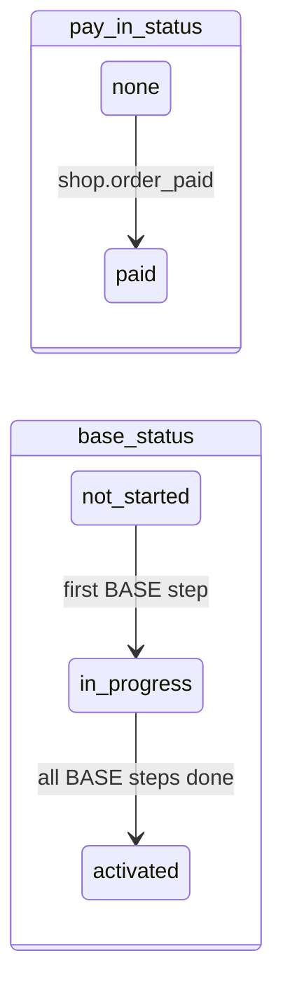

**gentrep_invite**

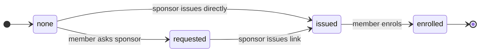

**Invite stage (one row per shared invite, in Lifestyle)**

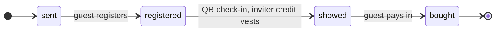

### D5. Core database (ER)

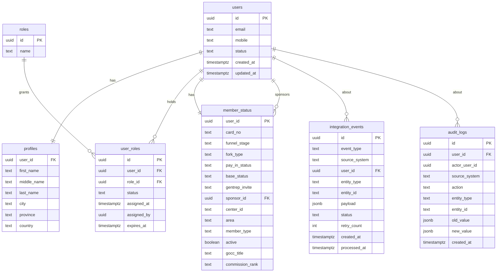

---

## 6. Access matrix

This replaces the v1 matrix. Gates in Section 4 still apply on top of roles.

| Role | Website / Shop | Lifestyle | GEMA | Academy | GG Verse | BioScan / GLIS | Admin |
|---|---|---|---|---|---|---|---|
| Prospect | Public | Rewards mode | Event link only | No | No | No | No |
| Lifestyle Member | Yes | Member mode | No | No | No | Own results | No |
| Affiliate | Yes | Member mode + share | No | No | No | Own results | No |
| Gentrep Seller | Yes | Member mode | No | To confirm | Commission view (to confirm) | Own results | No |
| Gentrep Builder | Yes | Member mode + My Team | Yes | Yes | Yes | Own results | No |
| Doctor | Yes | No | No | No | No | Consenting patients only | No |
| Instructor / Course Director | Yes | As member | Yes | Instructor tools | As member | Own results | No |
| Event Supervisor | Yes | As member | Approve, sign AER | As member | As member | Own results | No |
| Staff | Limited | Support view | By assignment | By assignment | Limited | Medical staff only | By assignment |
| Admin | Yes | Yes | Yes | Yes | Yes | Audit-logged only | Yes |

---

## 7. Data ownership

The devs' rule stays: each app owns its business data, and Core owns identity, access and integration. The biggest change is Lifestyle: it owns product use, not only prospects.

| System | Owns |
|---|---|
| Core | Users, profiles, roles, member_status, sponsor link, center and area, integration_events, audit_logs |
| Lifestyle | Rewards card, invites (link token and stage: sent, registered, showed, bought), E-Points ledger (point_events, the single E-Points record), dosing settings, dose logs (Reveille / Midday / Taps), ATP day, adherence (x/7, x/28), reminders, 5-Night Watch nights, BASE progress, Story of Hope consent |
| Shop | Products, prices, cart, orders, payments (Maya), subscriptions, delivery status, inventory |
| GEMA | Events, event links, registrations, QR check-ins, Event Requests with named role holders, AERs, training credit lines |
| Gentrep Academy | Courses, lectures, Zoom attendance, enrolments, title checklists (Needed / Done / Left), titles earned, certificates |
| GG Verse | Genealogy, sales and BV, commissions, ranks, incentives, Members Shop access |
| BioScan / GLIS | Lab results, GLIS scores, MiAge results, health consent. Medical data never leaves this system except as a score the member has agreed to share |
| Lifestyle Coach | Message rules, messages sent, sponsor alerts. It reads events; it owns no member data |

### D6. Lifestyle main tables (ER)

Field names are proposed. Devs may adjust names, not the meaning.

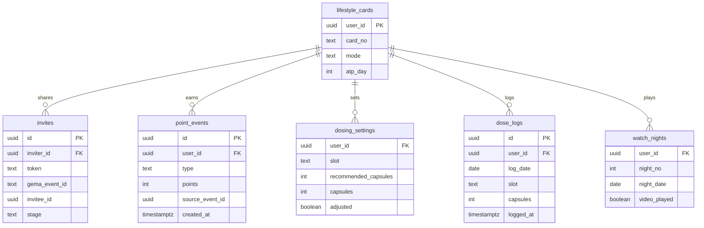

- `slot` values: `reveille`, `midday`, `taps`
- `mode` values: `rewards`, `member`
- `stage` values: `sent`, `registered`, `showed`, `bought`

---

## 8. Integration events

Use the devs' `integration_events` table exactly as written in v1 (PostgreSQL, JSONB payload, status, retry_count). This table is also our funnel meter and the Coach's trigger source, so it is built in Phase 1.

Keep the v1 event names. Add these:

```text
invite.sent
invite.registered
prospect.registered
event.checked_in            -> triggers referral.vested
referral.vested

member.paid_in
points.earned
points.redeemed

lifestyle.dose_logged
lifestyle.taps_logged
lifestyle.night_completed   (5-Night Watch, Nights 1-5)
lifestyle.atp_day_reached

base.step_completed
base.activated

gentrep.invite_requested
gentrep.invite_issued
gentrep.enrolled

gema.event_requested
gema.event_approved
gema.aer_signed             -> triggers academy.credit_awarded
academy.credit_awarded
academy.title_earned

shop.delivered              -> starts 5-Night Watch Night 1
shop.subscription_renewed

glis.result_uploaded
glis.scored

coach.message_sent
coach.sponsor_alerted
member.became_active
member.became_inactive
```

### D7. Event trigger map

What each key event causes.

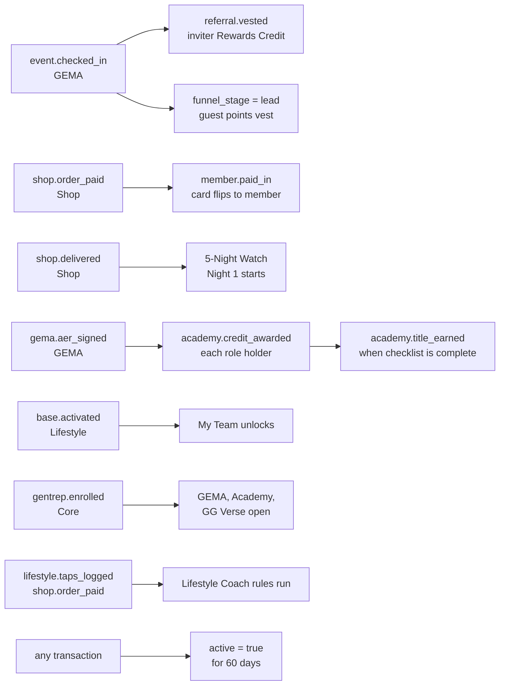

### D8. Event processing pipeline

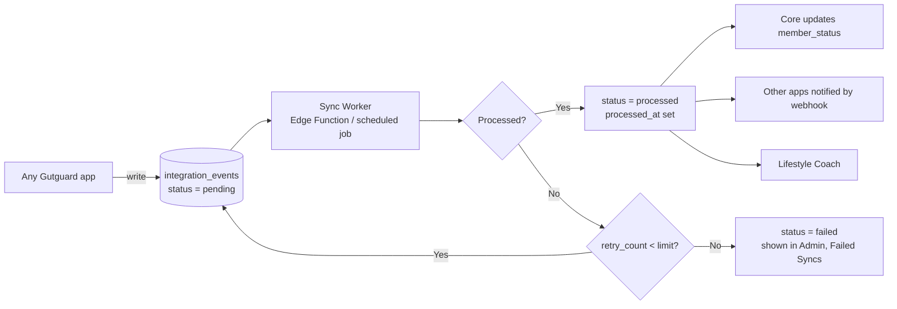

---

## 9. Key flows

These flows replace the v1 prospect and membership flows (v1 sections 4, 9, 10 and 11).

### D9. Single Sign-On (from v1, unchanged)

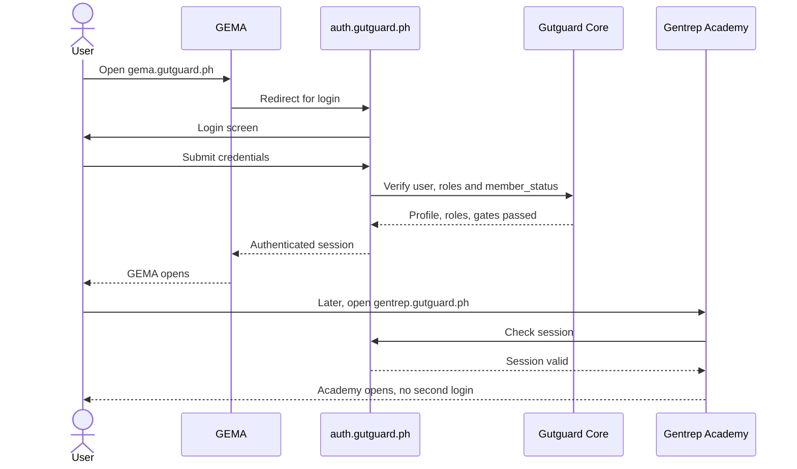

### D10. Guest to member

1. A member shares a GEMA event link.
2. The guest registers with name and mobile. A Lifestyle card opens in Rewards mode with pending points.
3. The guest attends and the card QR is scanned at check-in. The guest's points vest. The inviter's Rewards Credit vests.
4. The guest taps "Start my Lifestyle Protocol" and pays in the Shop (card number carried in the link).
5. The card flips from GUEST to LIFESTYLE MEMBER with the same number. Lifestyle opens in Member mode with no second login.

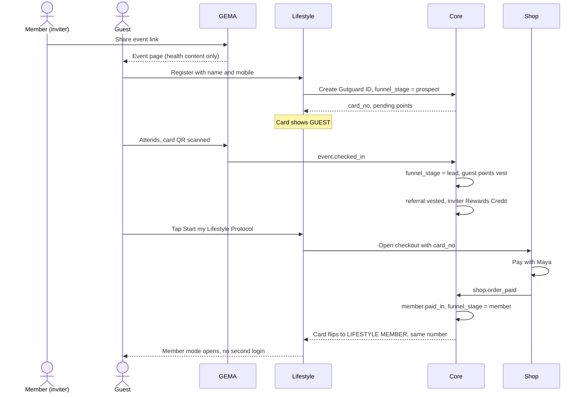

### D11. 5-Night Watch trial

1. The buyer pays ₱499 in the Shop. Shipping is free.
2. The courier's "Delivered" status starts Night 1 automatically.
3. Each night at Taps, Lifestyle plays that night's short video (Nights 1 to 5).

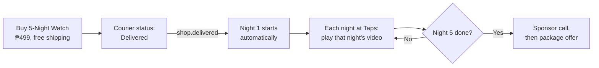

### D12. Member to Gentrep

1. The member completes BASE Activation in Lifestyle.
2. The sponsor issues a Gentrep invite for that member.
3. The member enrols. GEMA, Gentrep Academy and GG Verse open.

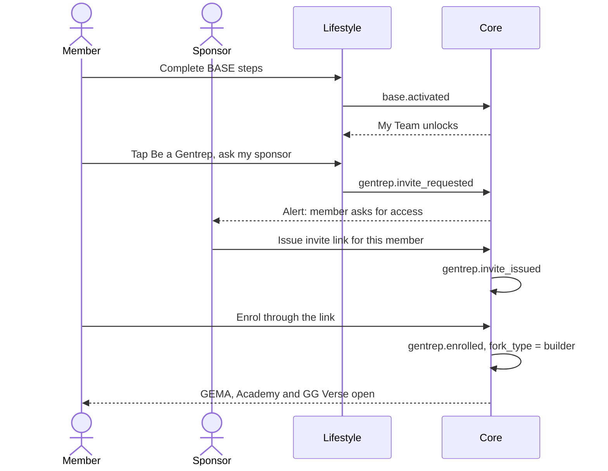

### D13. GOCC credit

1. An Event Manager (PL or CC) submits a GEMA Event Request naming every role holder.
2. Management approves. The event runs. Attendees check in by QR.
3. The Event Supervisor signs the AER within 24 hours.
4. Each named role holder gets a credit line on his Training Record. Academy updates the title checklist.

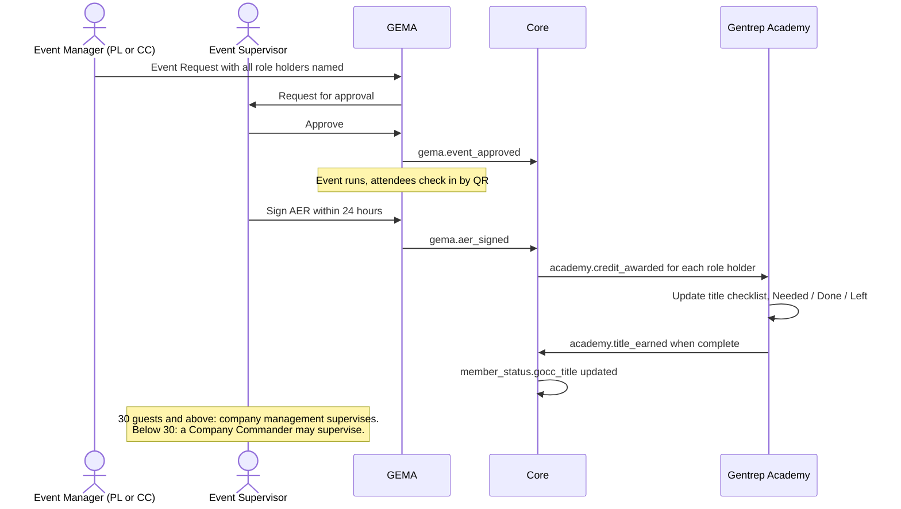

### D14. Lifestyle Coach, Phase 1

1. The Coach reads two sources only: Lifestyle dose and Taps logs, and Shop orders.
2. It sends Col. Lacto's message to the member and alerts the sponsor when the member slips.
3. Its one KPI is Active Protocol Users.

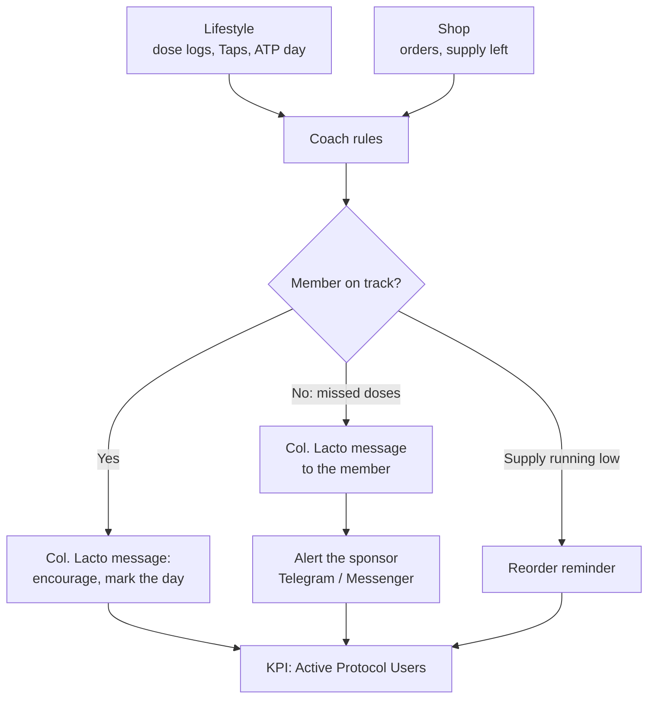

---

## 10. Tech stack, security and reporting

The devs' stack is adopted as written. Three items are added: payments, messaging and design tokens.

| Layer | Choice |
|---|---|
| Frontend | Next.js, React, TypeScript, Tailwind CSS |
| Login | Supabase Auth behind auth.gutguard.ph, OAuth 2.0 / OpenID Connect style SSO |
| Database | PostgreSQL on Supabase, Row Level Security on |
| API | Next.js route handlers and Supabase Edge Functions at api.gutguard.ph |
| Events | integration_events table, webhooks, Edge Functions, scheduled workers. No Kafka or RabbitMQ in version 1 |
| Payments (added) | Maya only at launch. Monthly payment link until Maya card-on-file is ready. No COD, no instalments |
| Messaging (added) | Telegram bot and FB Messenger for sponsor alerts and member reminders; app push notifications for the Coach |
| Design (added) | Shared ggverse-theme tokens. Shop and Lifestyle share the website's look. GEMA, Academy and GG Verse may keep their own look. The membership card keeps its royal blue and silver identity |

**Security:** Adopt the devs' 10 security rules and the `audit_logs` table. Two additions:

- The gates in Section 4 are checked in Core on the server, every time.
- Health data (GLIS, MiAge, Story of Hope) needs the member's consent under RA 10173 before it is stored or shared.

**Reporting:** Management dashboards live in `admin.gutguard.ph`. Obsidian is kept for developer documentation only. No member names or health data go into the vault, because vault files sit on personal laptops.

---

## 11. Build phases

Five phases. The event log moves into Phase 1, because the funnel numbers, the Coach and the Officer Dashboard all depend on it.

1. **Phase 1: Identity, member record and event log.** Gutguard ID, the v1 tables, member_status, integration_events and audit_logs. *Done when:* one login works, every person has one record, and every action is counted.
2. **Phase 2: Buy and use.** Shop with Maya, and Lifestyle in both modes (Rewards and Member), including the 5-Night Watch nights. *Done when:* a guest can register, attend, pay and land in Member mode with the same card.
3. **Phase 3: Connect the business apps.** Map existing GEMA, Gentrep Academy and GG Verse users to the Gutguard ID. Wire check-in to referral vesting, and the AER to training credits. *Done when:* a QR scan vests a referral and a signed AER writes a credit.
4. **Phase 4: Coach and health.** Lifestyle Coach Phase 1 (dose logs and orders only). BioScan / GLIS connected with consent.
5. **Phase 5: Admin and reports.** admin.gutguard.ph with users, roles, AER audit, failed syncs and management dashboards.

### D15. Build phases

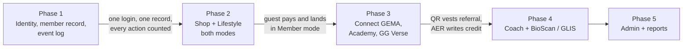

---

## 12. Open decisions

These need a ruling before the devs build the affected parts.

- [ ] **Members Shop:** a separate store, or a gated section of shop.gutguard.ph opened from GG Verse? The proposal is the gated section: one shop backend, gated by pay_in_status.
- [ ] **MiAge display:** where does the member see MiAge? The BioScan card shows inflammation only, so MiAge needs its own place, for example Lifestyle My Journey.
- [ ] **Operation 50 Stories:** does the challenge need GLIS scoring in the app at launch, or can the first season be scored by hand from partner-lab results? If in the app, BioScan / GLIS moves up to Phase 2.
- [ ] **E-Points values:** final earn values and the redemption cap come from the official marketing plan.
- [ ] **Officer Readiness Rating:** the 1 to 100 formula for the Gentrep Officer Dashboard.
- [ ] **Doctor access:** what a Clinical Partner doctor can see in BioScan / GLIS, and whether doctors need their own portal.
- [ ] **Gentrep Seller access:** does a Seller see Gentrep Academy, and where does a Seller view his direct commission (GG Verse or Lifestyle)?
